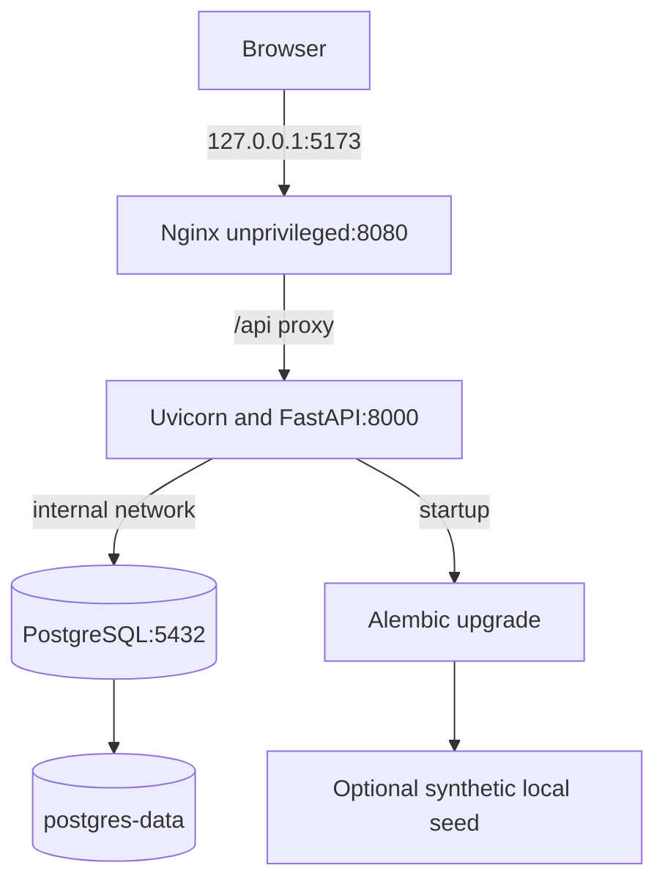

# Container view

## Phase 8 implementation

The local Compose definition builds a static frontend image, a FastAPI image,
and PostgreSQL. The database is on the internal Compose network and persists
in a named volume; only the web and API ports are published, bound to loopback.

Compose waits for PostgreSQL health before starting the API. The API entrypoint
applies migrations, optionally inserts idempotent demo data, and then launches
Uvicorn. The web service waits for API readiness. The local auth adapter and
demo seed are enabled only by this development Compose configuration.

The backend runtime uses a non-root user and installs locked runtime
dependencies. The frontend is built with Node and served by the unprivileged
Nginx image. Neither build context includes local environment files or SQLite
databases. Compose image tags are `ripple-effect-api:local` and
`ripple-effect-web:local`; release version/SHA tags and the registry digest
must be recorded after an approved registry publish.

## Verification status

On 2026-11-09, Docker Desktop Linux engine 29.8.2 built both images and started
the isolated Compose stack. PostgreSQL, API and web health checks passed. The
smoke script passed against PostgreSQL and Nginx; an additional browser journey
connected through Nginx, created an event, added a trigger, opened it, and ran
analysis. The API ran as `appuser` and Nginx as its unprivileged `nginx` user.
The test stack and its temporary database volume were removed afterward; the
local image tags remain available. A first API startup exposed CRLF line
endings in the shell entrypoint; `.gitattributes` now pins shell scripts to
LF, and the rebuilt stack passed.

The approved PR workflow is in `.github/workflows/ci.yml`, but has not run on
GitHub because no remote push was approved. Its dependency and container
scanning results remain unverified.
