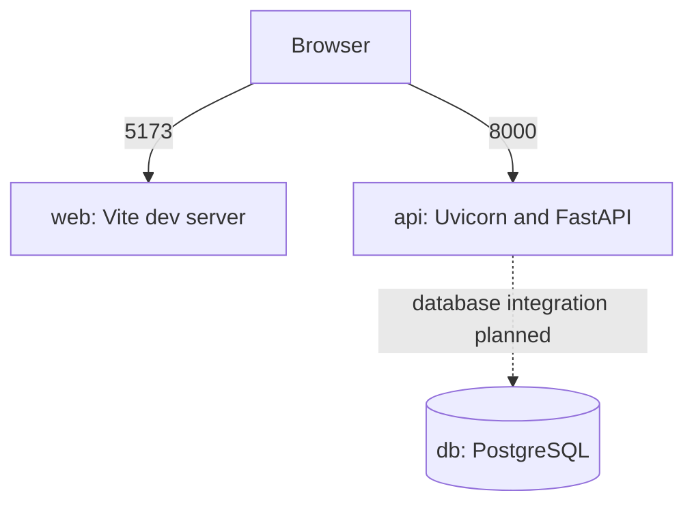

# Container view

## Phase 1 status

`docker-compose.yml` defines web, API, and PostgreSQL services. The Docker CLI is installed, but the Docker daemon was unavailable during this phase; image builds and container startup are therefore unverified. The API does not yet use PostgreSQL.

Phase 1 images are local development images. Production image hardening belongs to the delivery phase.
