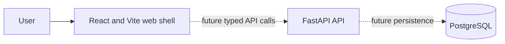

# System context

## Phase 1 status

Implemented locally: a React/Vite web shell and a FastAPI process with liveness/readiness routes. Persistence, authentication, tenant authorization, events, graph analysis, scenarios, and deployment are planned, not implemented.

The dashed edges are planned integrations. The Phase 1 screen does not yet make API calls.
