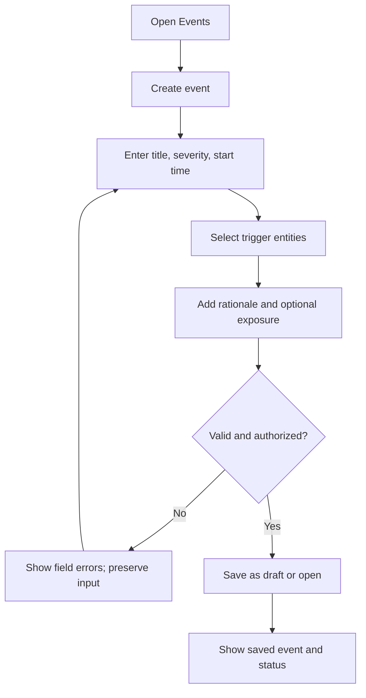
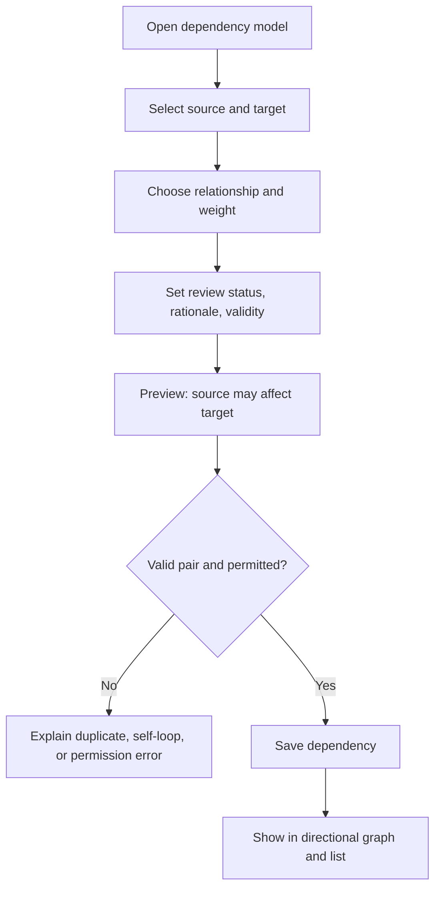
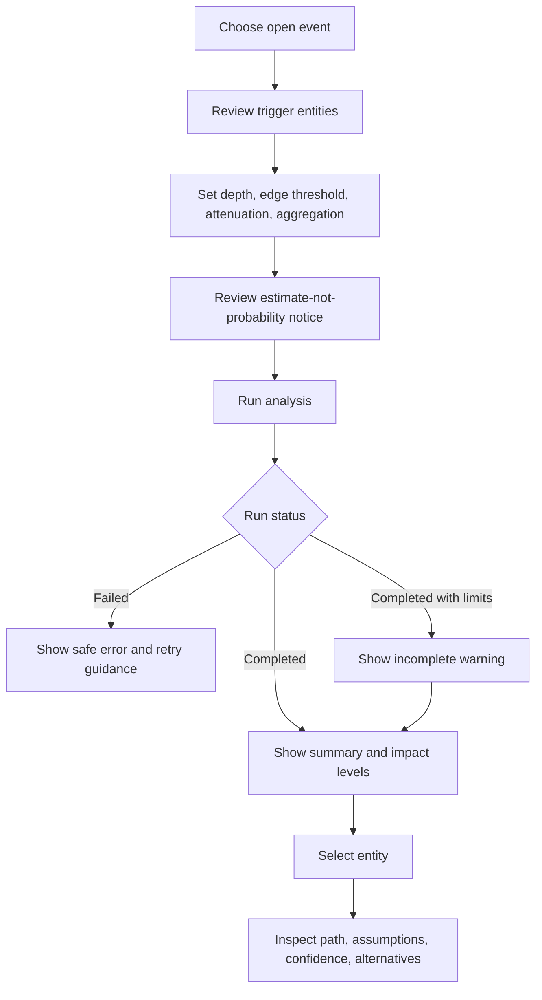
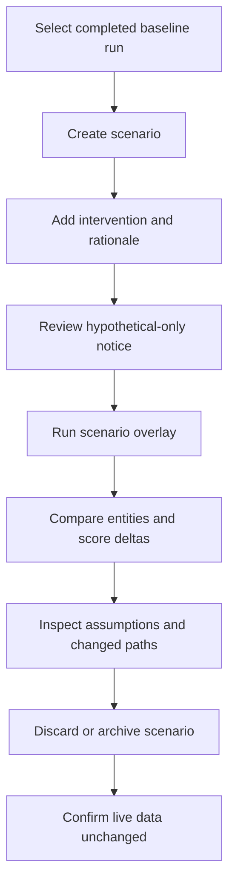

# Task flows

> **Design proposal — not observed behavior.** Flows are derived from the required journeys. Validate sequencing, labels, and failure recovery with participants.

## A. Register an event

Questions: who may open an event; can a draft be previewed; what makes a trigger required?

## B. Maintain a dependency

Questions: how are duplicate relationships noticed; who reviews a draft dependency; how are temporal changes handled?

## C. Run and inspect analysis

Questions: which configuration values should be defaults; which result details need explanation first?

## D. Create and compare a scenario

Questions: how should users identify scenario versions; which differences need emphasis; what retention behavior is expected?
